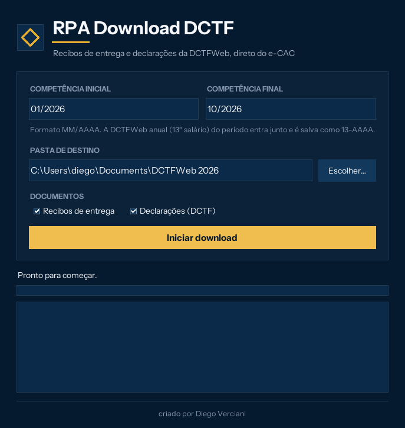

# RPA Download DCTF

Baixa de uma vez os **recibos de entrega** e as **declarações da DCTFWeb** no e-CAC, para o período e a pasta que você escolher.

### [⬇ Baixar para Windows (RPA-Download-DCTF.exe)](https://github.com/diegoverciani-gif/rpa-download-dctf/releases/latest/download/RPA-Download-DCTF.exe)

[Guia do usuário (PDF)](https://github.com/diegoverciani-gif/rpa-download-dctf/releases/latest/download/Guia-do-usuario-RPA-Download-DCTF.pdf) · [Todas as versões](https://github.com/diegoverciani-gif/rpa-download-dctf/releases) · [Vitrine de aplicações](https://vitrine-diego-verciani.netlify.app)

## Como usar
1. Baixe o `RPA-Download-DCTF.exe` e dê dois cliques. Não precisa instalar nada.
2. Informe a competência inicial e a final (MM/AAAA) e escolha a pasta de destino.
3. Clique em **Iniciar download**. O navegador abre no login do e-CAC.
4. Faça o login (certificado digital ou gov.br prata/ouro). Procurador: troque o perfil para a empresa.
5. Clique em **Continuar** na caixa do robô. Ele baixa tudo e grava um relatório em Excel na pasta.

Os arquivos saem como `Recibo - MM-AAAA.pdf` e `DCTF - MM-AAAA.pdf` (a DCTFWeb anual do 13º salário sai como `13-AAAA`).

## Requisitos
- Windows 10 ou 11 com Microsoft Edge (já vem instalado) ou Google Chrome.
- Acesso ao e-CAC com permissão para a DCTFWeb.

## Aviso do Windows na primeira vez
O programa não tem assinatura digital paga, então o navegador pode avisar que o arquivo "não é baixado com frequência" (clique em **Manter**) e o Windows pode mostrar "O Windows protegeu o computador" (clique em **Mais informações** > **Executar assim mesmo**). O código-fonte está todo neste repositório para quem quiser conferir.

## Privacidade
- O login é feito por você, direto no site do e-CAC. O robô não vê nem guarda senha ou certificado.
- Nada sai do seu computador: os PDFs e o relatório vão só para a pasta que você escolher.

## Limites
- Cobre a **DCTFWeb**. A DCTF Mensal (PGD) de períodos até dezembro de 2024 não pode ser baixada pelo e-CAC.
- Baixa só a declaração com situação **Ativa** (a vigente).
- **Versão beta**: em validação na tela real do e-CAC. Se algo não funcionar, o robô pede ajuda na própria janela e guarda um diagnóstico em `%LOCALAPPDATA%\RPA Download DCTF\diagnostico`.

## Para desenvolvedores
O robô é `rpa_download_dctf.py` (Python + Playwright + Tkinter). O executável é gerado pelo GitHub Actions ao publicar uma etiqueta `v*`, ou localmente com `gerar_exe.bat` (Python com Tcl/Tk).

---
Criado por **Diego Verciani**. A fonte Instrument Sans é distribuída sob a licença SIL Open Font License (ver `assets/OFL-InstrumentSans.txt`).
